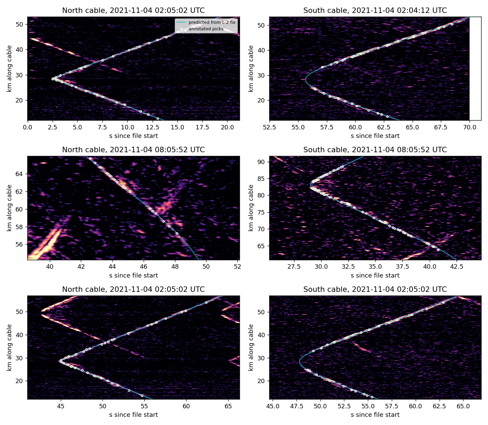
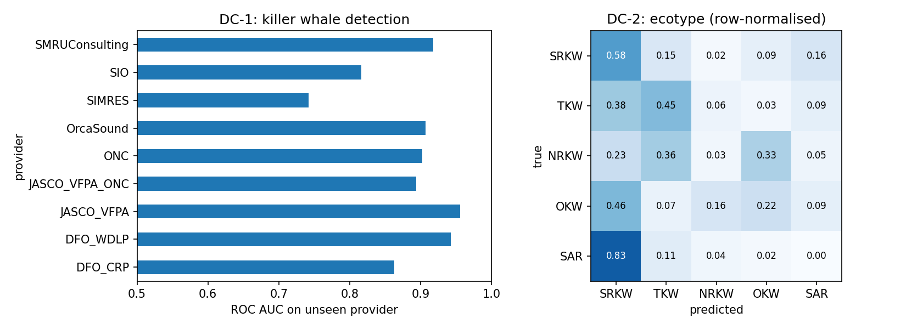

# DCLDE 2027 challenges: an unofficial, for-fun attempt

Code and results for the three [DCLDE 2027 challenges](https://www.dclde.org/challenges-and-data-sets),
built on the public datasets in NOAA's `noaa-passive-bioacoustic` bucket. This is not a submission: there
is no released test set yet, so every number below comes from held-out training data, which is described
case by case.

| Challenge | Task | Approach | Headline result |
|---|---|---|---|
| **L-1** | Fin whale 2-D localisation, one DAS cable | Least-squares time-of-arrival fit with a grid-search start | Median 355 m from the two-cable fix when the left/right side is right; side correct 65% of the time |
| **L-2** | Fin whale 3-D localisation, two DAS cables | Joint fit with cross-cable call association | 206 calls; median ±213 m (1σ) horizontally; depth not resolvable |
| **DC-1** | Detect killer whale calls | Small CNN on log-mel spectrograms, tested on unseen recorders | ROC AUC 0.88, F1 0.87 on recorders the model never saw |
| **DC-2** | Classify killer whale ecotype | Same CNN, 5 ecotypes | Hard: balanced accuracy 0.25 (chance 0.20); resident vs transient AUC 0.71 |
| **DE-1** | Right whale abundance, Cape Cod Bay | TDoA call association + quasi-Poisson calibration to aerial counts | Leave-one-out error ±13 whales (RMSE); reproduces the published pipeline |

---

## Localization (L-1, L-2): fin whales on fibre-optic cables


Distributed acoustic sensing (DAS) turns a telecom fibre into tens of thousands of strain sensors.
Above, each "V" is one fin whale call sweeping along 54 km of the OOI North cable off Oregon. The tip
of the V is the point on the cable closest to the whale. The challenge provides the hand-picked arrival
times (cyan circles), so localisation never touches the 103 GB of raw strain data.

**Model.** For a whale at **s** calling at time *t₀*, a pick at cable point **rᵢ** arrives at
*tᵢ = t₀ + |s − rᵢ| / c*. Fixes come from robust least squares (soft-L1), started from a 1 km grid
search so the fit cannot get stuck in a local minimum.

**What I found in the data**
- Some annotation `call_id`s contain two different calls about 40 s apart. Picks are split into
  physically consistent tracks (an arrival curve cannot move along the fibre faster than 1/*c*).
- `call_id` is not shared between the North and South cables. Calls are paired across cables by
  testing whether one joint fit explains both sets of picks (RMS < 0.15 s), best fits first.
- The effective sound speed that minimises residuals is **1450 m/s**, below true water sound speed. That
  is expected, because straight-line rays ignore refraction and the seafloor path to the cable.
- **No ground-truth positions are in the bucket yet**, although the dataset description says they exist.
  L-1 is therefore scored against L-2, which is an independent, better-constrained estimate.


| Metric | Value |
|---|---|
| Annotated calls → tracks after splitting | 794 → 801 |
| L-1 fixes / passing quality check | 769 / 538 |
| L-1 median residual | 71 ms |
| L-1 calls with an unambiguous side (mirror solution ≥ 2× worse) | 17% |
| L-1 side correct (vs L-2) | 65% |
| L-1 median error vs L-2, correct side | 355 m |
| L-2 cross-cable pairs | 206 |
| L-2 median residual | 91 ms |
| L-2 median 1σ horizontal | 213 m |
| L-2 depth | median −12 m, but 1σ ≈ 600 m, so not resolved |

On the map, the L-2 fixes form tight clusters (individual whales). One cluster south of the cables moves
steadily south-west over about 10 hours: a whale swimming while it calls.

**Limitations.** A single cable mostly cannot tell which side the whale is on, because the mirror image
fits almost as well. Depth is not recoverable with a constant-speed straight-ray model. A ray-traced or
modal propagation model would be the next step.

### Reading the raw DAS data from the cloud, without downloading it

The 240 NetCDF files (103 GB) store their SNR images as compressed HDF5 chunks of about
1.4 km × 3.7 s. [`src/dclde/das_remote.py`](src/dclde/das_remote.py) opens a file over HTTPS, which
reads only its metadata, then fetches just the chunks that overlap the window you slice:

```python
from dclde import das_remote as R
R.list_files()                                    # all 240 files, nothing downloaded
w = R.window("North", "2021-11-04 02:00:02", dist_m=(45e3, 52e3), time_s=(3, 15))
```

[`scripts/remote_call_check.py`](scripts/remote_call_check.py) uses this to stream the raw window
around several L-2 calls and overlay the arrival curve predicted from our fitted position:



The predicted curves follow the signal on both cables, including stretches with no annotated picks.

| Access pattern (home broadband) | Time |
|---|---|
| Open a file (metadata only) | ~9 s |
| 2 km × 10 s window | ~3 s |
| A full call (~20 km × 20 s) | 20–50 s |
| Every 500th channel over a whole file | ~270 s, because it touches nearly every chunk |

Rule of thumb: stream targeted windows from home. For full-file or all-file processing, run the same code
on a Google Cloud VM or in Colab, next to the bucket (US multi-region). Reading many files repeatedly is
faster still with a one-time `kerchunk` or `VirtualiZarr` index, which removes the per-file metadata read.

---

## Detection & Classification (DC-1, DC-2): killer whales in the Salish Sea

The dataset ([Palmer et al. 2025](https://www.nature.com/articles/s41597-025-05281-5)) holds about 1.6 TB
of audio from 11 organisations' hydrophones, annotated for killer whales of five ecotypes (southern and
northern residents SRKW/NRKW, transient/Bigg's TKW, offshore OKW, and Southern Alaska residents SAR)
plus humpbacks (HW), other biological sounds (UndBio) and background (AB).

**Data.** Rather than download it all, [`build_kw_dataset.py`](scripts/build_kw_dataset.py) samples up to
300 annotations per provider and label, and range-reads a 3 s clip around each one: **9,633 clips**.
Each clip becomes a 96-band log-mel spectrogram (200 Hz–15.5 kHz at 32 kHz), with the median of each
band removed to suppress the recorder's own noise floor.

**Model.** A small 4-block CNN with SpecAugment-style masking, trained for 12 epochs on CPU.

**Evaluation that means something.** Every recorder sounds different, so a random split would let the
model learn the hydrophone rather than the whale. Instead, each of 5 folds holds out whole *providers*,
and every score below comes from recorders the model never saw.



**DC-1, detection** (killer whale vs humpback, other biological sounds and background)

| Metric | Value |
|---|---|
| ROC AUC | 0.882 |
| Average precision | 0.899 |
| F1 at threshold 0.5 | 0.866 |
| Balanced accuracy | 0.818 |
| False alarms at 0.5: background / humpback / other biological | 15% / 20% / 56% |

Detection carries across recorders well: AUC is 0.86–0.96 for most providers. SIMRES is the outlier
(0.74). Most false alarms come from the "other biological" class, unidentified tonal sounds that are
easily confused with killer whale calls even by ear.

**DC-2, ecotype.** This is far harder, and the honest result is that a small model on 3 s clips barely
does it across recorders:

| Metric | Value |
|---|---|
| Balanced accuracy, 5 classes (chance 0.20) | 0.254 |
| SRKW vs TKW ROC AUC | 0.709 |
| SRKW vs TKW balanced accuracy | 0.660 |

Each ecotype is recorded mostly by a few providers, so holding out a provider often removes most of that
ecotype's training data. For example, all SAR clips come from one provider, so when it is held out the
model has never heard SAR and labels it SRKW. Residents and transients, which have the most data across
many recorders, do separate (AUC 0.71). Better DC-2 results would probably need longer context (whole
call sequences, not 3 s clips), call-type labels, or a large pretrained audio model, plus much more of
the 1.6 TB.

Trained models are saved locally in `models/` (git-ignored); predictions are in `results/killer_whales/`.

---

## Density Estimation (DE-1): right whales in Cape Cod Bay

Five recorders (MARUs) logged 116 days in 2019. A CNN produced 495,038 upcall detections (score ≥ 0.75),
and on 16 days aircraft photographed every right whale in the bay.

1. **Association.** One call is often heard on several recorders. A detection set counts as one call if
   some source location inside the bay explains its time differences (τ = 0.5 s, *c* = 1470 m/s), and
   recorders that missed it are farther away. This yields **249,395 distinct upcalls**; the paper reports
   249,539.
2. **Counting.** Distinct calls per day in the median flight window (09:12–15:09 EST).
3. **Estimating abundance** in two ways:

| Method | Uses aerial data? | Error vs aerial counts |
|---|---|---|
| A. Cue counting, 6 upcalls per whale per hour (literature) | no | RMSE 41 whales; underestimates ~5× |
| B. Quasi-Poisson calibration, square-root model | yes | RMSE 11.4; **leave-one-out RMSE 13.2** |


The comparison shows something interesting. To match the aerial counts, method A needs a population-level
daytime call rate of only **≈1.2 upcalls per whale per hour** (IQR 0.9–1.7), much less than the 6–8 per hour
often quoted. Right whales call much more at night, and many whales are silent at any given moment, so
borrowing a call rate is the weakest link in pure cue counting. Calibrating to the aerial counts avoids
the problem.

Our fitted coefficients match the paper's (for example, linear model α = 2.69, β = 0.003, against 2.69 and
0.00275 in the paper). The log and square-root models are effectively tied (CV RMSE 13.26 vs 13.25); the
paper chose the log model. The spikes on the plot, such as 27 April, are days with more calls than any
calibration day, so those estimates are extrapolations and are flagged in `daily_abundance.csv`.

---

## Running it

```bash
pip install -r requirements.txt
python scripts/download.py            # ~450 MB of annotations, geometry and detections
python scripts/run_localization.py    # L-1, L-2      (~1 min)
python scripts/run_density.py         # DE-1          (~1 min)
python scripts/build_kw_dataset.py    # streams ~9,600 killer whale clips (~15-30 min, ~10 GB cached)
python scripts/run_killer_whales.py   # DC-1, DC-2    (CPU, ~3 h)
python -m pytest
```

Data stays in `data/` (git-ignored). Raw DAS and the 1.6 TB of killer whale audio are never downloaded
in bulk: WAV clips are read with HTTP range requests.

```
src/dclde/
  gcs.py        public-bucket access (listing, download, byte ranges)
  das_loc.py    DAS geometry, pick loading, track splitting, L-1/L-2 solvers, association
  das_remote.py stream windows of the raw DAS NetCDF files from the bucket (no download)
  kw_data.py    killer whale annotations, clip streaming, log-mel features
  kw_model.py   CNN, augmentation, training
  narw.py       right whale detections, TDoA association, cue counting, quasi-Poisson
scripts/        one script per challenge + download + figures
results/        CSVs and figures produced by the scripts
tests/          synthetic checks of the solvers and models
```

## Data and credits

All data are from the DCLDE 2027 organisers via NOAA NCEI (CC-BY-4.0). Please cite the original datasets:

- DAS fin whales: DOI [10.25921/v2vh-8w16](https://doi.org/10.25921/v2vh-8w16); Goestchel et al. (JASA, accepted). Data from the OOI RCA DAS experiment.
- Killer whales: DOI [10.25921/15ey-mh50](https://doi.org/10.25921/15ey-mh50); [Palmer et al. 2025, *Sci. Data*](https://www.nature.com/articles/s41597-025-05281-5).
- Right whales: DOIs [10.25921/ab3a-c842](https://doi.org/10.25921/ab3a-c842), [10.25921/x68p-cj94](https://doi.org/10.25921/x68p-cj94); [Garcia, Tolkova et al. 2025, *Endang. Species Res.* 56:101](https://www.int-res.com/abstracts/esr/v56/esr01384). Aerial surveys by the Center for Coastal Studies (NOAA permit 19315-01).

Code: MIT licence (see `LICENSE`).
